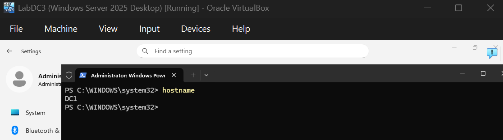
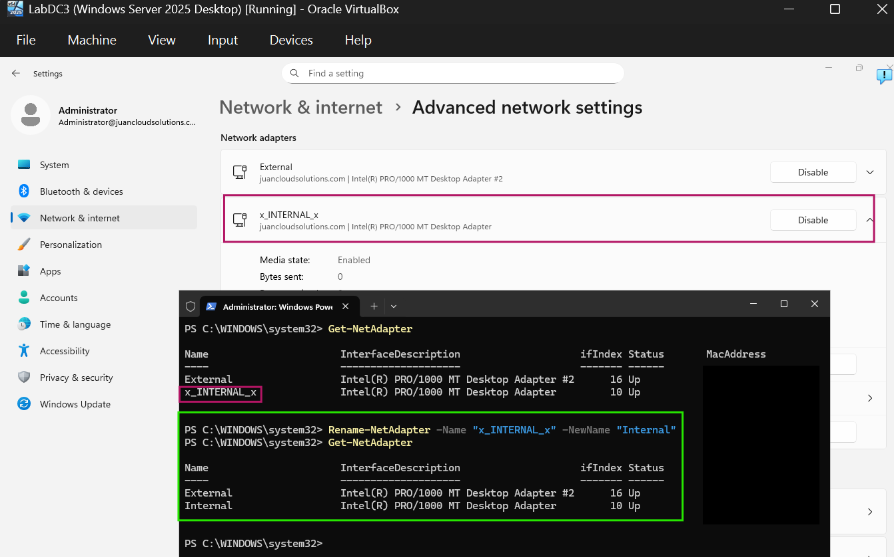
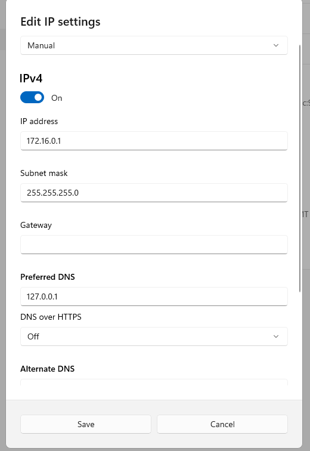
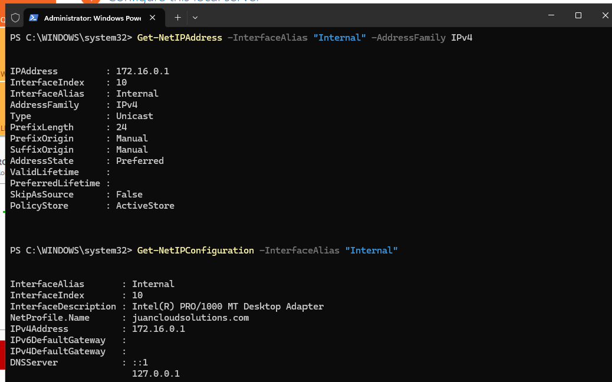
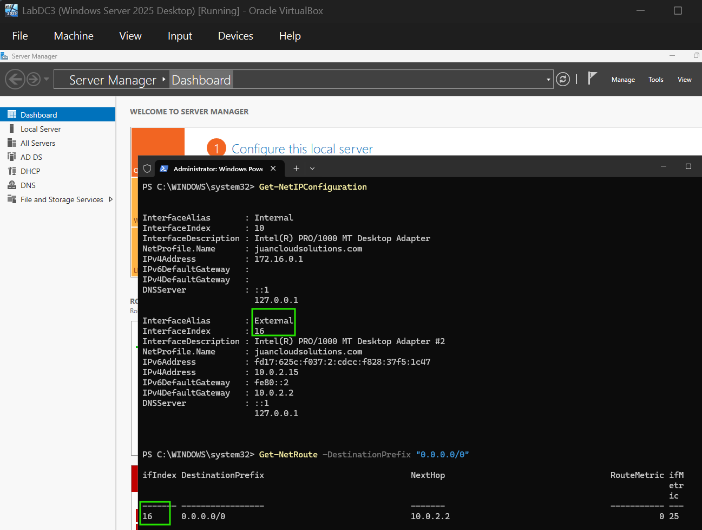
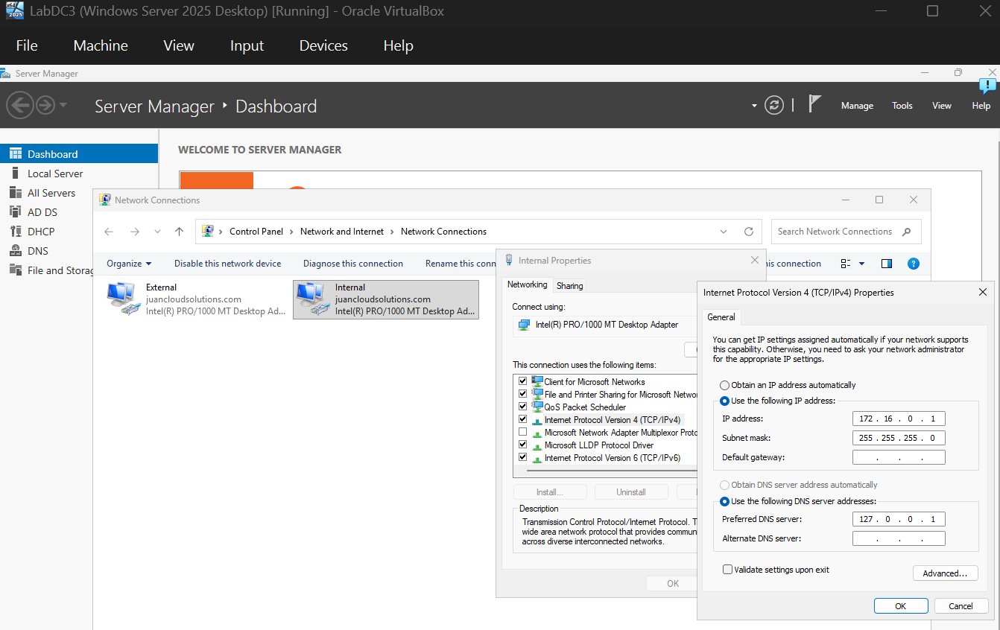

# Server Configuration

## Table of Contents

1. [Overview](#1-overview)
2. [Initial Server Configuration](#2-initial-server-configuration)
   - [2.1 Computer Name Configuration](#21-computer-name-configuration)
   - [2.2 Network Adapter Identification](#22-network-adapter-identification)
3. [Network Configuration](#3-network-configuration)
   - [3.1 Static IPv4 Address Configuration](#31-static-ipv4-address-configuration)
   - [3.2 Subnet Mask and Default Gateway](#32-subnet-mask-and-default-gateway)
   - [3.3 DNS Client Configuration](#33-dns-client-configuration)
4. [PowerShell Administration](#4-powershell-administration)
5. [Configuration Verification and Troubleshooting](#5-configuration-verification-and-troubleshooting)
   - [5.1 Computer Name Verification](#51-computer-name-verification)
   - [5.2 Network Adapter Verification](#52-network-adapter-verification)
   - [5.3 IP Configuration Verification](#53-ip-configuration-verification)
   - [5.4 DNS Client Verification](#54-dns-client-verification)
   - [5.5 Initial Network Findings](#55-initial-network-findings)
6. [Next Steps: Server Roles and Network Services](#6-next-steps-server-roles-and-network-services)
7. [Outcome](#7-outcome) 

---

## 1. Overview

This phase covers the initial configuration of the Windows Server 2025 virtual machine designated as the domain controller (DC1).

The primary objectives are to establish the server's identity, identify and configure its network adapters, assign static IP addressing, and prepare its network settings for the subsequent deployment of Active Directory Domain Services (AD DS) and other network services.

DC1 is configured with two network adapters:

- **External:** Connected to the VirtualBox NAT network to provide external network connectivity.
- **Internal:** Connected to the VirtualBox Internal Network to establish communication with the client workstation.

DC1 will eventually host Active Directory Domain Services (AD DS), DNS, DHCP, and routing services to support the lab environment.

## 2. Initial Server Configuration

### 2.1 Computer Name Configuration

Following the Windows Server 2025 installation, I renamed the computer to **DC1** to establish a consistent naming convention for the domain controller.

**Configuration Method: Windows GUI**

Steps performed:

1. Right-click the Start button.
2. Select **System**.
3. Select **Rename this PC**.
4. Enter `DC1` and complete the renaming process.
5. Restart the server to apply the change, if prompted.

**PowerShell Verification**

The following command displays the current computer name:

```powershell
hostname
```

**Expected Output:**

```text
DC1
```



**PowerShell Alternative**

The computer name can also be changed through PowerShell:

```powershell
Rename-Computer -NewName "DC1" -Restart
```

This command renames the computer and restarts the system to apply the change.

### 2.2 Network Adapter Identification

DC1 uses two network adapters to separate external and internal network connectivity.

Before configuring the network settings, I inspected the available adapters and their existing IP configurations to identify each adapter according to the network topology.

**Configuration Method: Windows GUI**

Steps performed:

1. Right-click the Start button.
2. Select **Network Connections**.
3. Navigate to **Advanced Network Settings**.
4. Locate the available network adapters.
5. Select **Hardware and Connection Properties** to inspect their configurations.

The initial network configuration showed:

- The external adapter received an IP address through the VirtualBox NAT network.
- The internal adapter initially returned an Automatic Private IP Addressing (APIPA) address because the isolated network did not yet have a DHCP server configured. Similar to
[CLIENT1 Initial IP Configuration](../Screenshots/Environment-Setup/07-Client-Initial-IP-Configuration.png)

I subsequently renamed the adapters to distinguish their intended functions:

- `External`
- `Internal`

**PowerShell Verification**

The following commands display the available network adapters and their configurations:

```powershell
# Display available network adapters
Get-NetAdapter

# Display network configuration for all adapters
Get-NetIPConfiguration

# Display detailed IP configuration
ipconfig /all
```

**PowerShell Alternative**

Network adapters can also be renamed through PowerShell:

```powershell
# Rename the external adapter
Rename-NetAdapter -Name "<Current Adapter Name>" -NewName "External"

# Rename the internal adapter
Rename-NetAdapter -Name "<Current Adapter Name>" -NewName "Internal"
```




## 3. Network Configuration

### 3.1 Static IPv4 Address Configuration

The internal network adapter requires a static IPv4 address because DC1 will serve as the domain controller and provide network services to the client workstation.

A consistent IP address is important for a domain controller because domain-joined devices and network services must be able to reliably locate it.

I assigned the internal adapter a static IPv4 address according to the network topology established during the environment setup phase.

**Configuration Method: Windows GUI**

Steps performed:

1. Right-click the Start button.
2. Select **Network Connections**.
3. Navigate to **Advanced Network Settings**.
4. Expand the network adapters.
5. Select **View Additional Properties** for the Internal adapter.
6. Locate **IP assignment** and select **Edit**.
7. Change the IP assignment from Automatic (DHCP) to Manual.
8. Enable IPv4.
9. Enter the assigned IP address, subnet prefix, and other applicable network settings.
10. Save the configuration.



**Internal Network Configuration**

| Network Property | Configuration |
|---|---|
| Adapter | Internal |
| Network Connection | VirtualBox Internal Network |
| IP Assignment | Static |
| IPv4 Address | 172.16.0.1 |
| Subnet Mask | 255.255.255.0 |
| Prefix Length | /24 |
| Default Gateway | Empty |
| Preferred DNS | 127.0.0.1 |

**PowerShell Verification**

The following commands display the assigned IPv4 address and associated network configuration:

```powershell
# Display the internal adapter's IPv4 address
Get-NetIPAddress -InterfaceAlias "Internal" -AddressFamily IPv4

# Display the adapter's complete IP configuration
Get-NetIPConfiguration -InterfaceAlias "Internal"
```


**PowerShell Alternative**

A static IPv4 address can also be assigned through PowerShell using `New-NetIPAddress`:

```powershell
New-NetIPAddress `
    -InterfaceAlias "Internal" `
    -IPAddress "<IPv4 Address>" `
    -PrefixLength <Prefix Length>
```

If the internal adapter requires a default gateway as part of the network design, the `-DefaultGateway` parameter can also be specified.

*Note: This is an alternative configuration method. The static IP address has already been assigned through the GUI. Do not execute this command against the existing configuration without first reviewing the current IP settings and understanding the changes it would make.*

### 3.2 Subnet Mask and Default Gateway

The subnet mask determines which IP addresses belong to the local network, while the default gateway provides a route to networks outside the local subnet.


**Network Configuration Considerations:**

- The internal adapter uses the static addressing scheme established for the lab network.
- The external adapter obtains its network configuration through the VirtualBox NAT connection.
- The default gateway configuration must follow the intended routing design.
- In this two-adapter configuration, the external interface should normally provide the server's default route. Avoid configuring competing default gateways on both adapters.

**PowerShell Verification**

```powershell
# Display IP configuration for both adapters
Get-NetIPConfiguration

# Display the server's default routes
Get-NetRoute -DestinationPrefix "0.0.0.0/0"
```

These commands help verify the assigned IP addresses, gateways, and routing configuration.



### 3.3 DNS Client Configuration

The internal network adapter requires DNS client settings that will allow DC1 to resolve its own domain and Active Directory resources after DNS Server has been deployed.

I configured the preferred DNS address to reference the server itself using the loopback address (`127.0.0.1`).

Alternatively, the server's own static internal IP address can be used as its preferred DNS address.

This configuration prepares the server to use its local DNS service once the DNS Server role has been installed and configured during the Active Directory deployment process.

**Configuration Method: Windows GUI**

The DNS client settings can be configured through the adapter's IPv4 properties.

Steps performed:

1. Navigate to **Network Connections**.
2. Open the properties for the Internal network adapter.
3. Locate **Internet Protocol Version 4 (TCP/IPv4)**.
4. Select **Properties**.
5. Enter the preferred DNS server address.
6. Save the configuration.



**PowerShell Verification**

```powershell
# Display DNS server settings for the internal adapter
Get-DnsClientServerAddress -InterfaceAlias "Internal"
```

**PowerShell Alternative**

The DNS client address can also be configured through PowerShell:

```powershell
Set-DnsClientServerAddress `
    -InterfaceAlias "Internal" `
    -ServerAddresses "127.0.0.1"
```

*Note: The DNS client setting does not install the DNS Server role. Local DNS resolution will depend on the DNS service being installed and configured. DNS Server deployment, including the AD-integrated DNS zone, is documented in Active-Directory-Deployment.md.*

## 4. PowerShell Administration

PowerShell provides an alternative to the graphical interface for configuring and administering Windows Server.

Although the initial configuration tasks in this phase were completed through the Windows GUI, PowerShell provides an opportunity to inspect the existing settings, verify the results, and learn equivalent administrative commands.

The following commands are relevant to the configuration tasks covered in this documentation.

| Command | Purpose |
|---|---|
| `hostname` | Display the computer name |
| `Get-NetAdapter` | Display available network adapters |
| `Get-NetIPConfiguration` | Display IP configuration for network adapters |
| `Get-NetIPAddress` | Display assigned IP addresses |
| `Get-NetRoute` | Display routing information |
| `Get-DnsClientServerAddress` | Display configured DNS client addresses |
| `Rename-Computer` | Change the computer name |
| `Rename-NetAdapter` | Rename a network adapter |
| `New-NetIPAddress` | Assign a static IP address |
| `Set-DnsClientServerAddress` | Configure DNS client settings |
| `ipconfig /all` | Display detailed network configuration |

Commands used to verify the existing configuration are distinguished from commands that modify the server.

Configuration commands should be reviewed before execution to avoid unintentionally changing an already configured system.

While some examples of PowerShell verification and configuration commands are documented here, additional PowerShell scripts and administrative tasks will be documented in the repository's `PowerShell/` directory in future updates.

## 5. Configuration Verification and Troubleshooting

After completing the initial server configuration, I used Windows tools and PowerShell to inspect the computer name, network adapters, IP addressing, and DNS client settings.

The following checks provide a reference for validating the configuration.

### 5.1 Computer Name Verification

```powershell
hostname
```

**Expected Result:**

```text
DC1
```

Confirms that the server is using the intended computer name.

### 5.2 Network Adapter Verification

```powershell
Get-NetAdapter
```

Confirm that both network adapters are present, enabled, and identified as `External` and `Internal`.

Check the adapter status to ensure that the virtual network interfaces are operational.

### 5.3 IP Configuration Verification

```powershell
ipconfig /all
```

Alternatively:

```powershell
Get-NetIPConfiguration
```

Verify that:

- The external adapter has the expected NAT-assigned IP configuration.
- The internal adapter has the assigned static IPv4 address.
- The subnet mask and prefix length match the network design.
- The default gateway follows the intended routing configuration.
- The DNS client settings match the intended configuration.

### 5.4 DNS Client Verification

```powershell
Get-DnsClientServerAddress -InterfaceAlias "Internal"
```

Confirm that the internal adapter references the intended DNS server address.

DNS resolution tests should be performed after the DNS Server role has been installed and configured.

### 5.5 Initial Network Findings

The initial network inspection identified the following conditions:

| Component | Initial Observation |
|---|---|
| External Adapter | Received network configuration through VirtualBox NAT |
| Internal Adapter | Initially returned an APIPA address before static IP configuration |
| Internal IP Assignment | Subsequently configured with a static IPv4 address |
| DNS Client | Configured to reference the local server |
| DHCP | Not yet deployed at the initial network verification stage |

The internal APIPA address was expected before DHCP deployment because the isolated network did not have a DHCP server available to assign an address.

**Troubleshooting Considerations**

| Observation | Possible Explanation |
|---|---|
| APIPA address on the internal adapter | DHCP was not available, or the adapter had not yet been assigned a static address |
| External adapter has no IP address | Verify that the VirtualBox NAT adapter is enabled and functioning |
| Incorrect static IP address | Review the assigned address and subnet configuration against the network topology |
| DNS resolution fails before DNS deployment | Verify that the DNS Server role has been installed and configured in new systems before treating this as a DNS service failure |
| Client cannot communicate with DC1 | Verify the client IP configuration, server IP address, and connectivity after DHCP and network services are deployed |

Client-server connectivity and DNS resolution will be tested again after the required network services have been configured.

## 6. Next Steps: Server Roles and Network Services

DC1 will eventually host several Windows Server roles to support the lab's network and domain infrastructure.

The installation and configuration of these services will be documented alongside their respective implementation procedures.

### 6.1 Active Directory Domain Services and DNS

Active Directory Domain Services will establish the Windows domain environment and provide centralized identity and directory management.

DNS Server will support domain name resolution and allow domain-joined devices to locate Active Directory services.

The installation of AD DS, domain controller promotion, and DNS Server deployment and configuration will be documented in:

[Active Directory Deployment](Active-Directory-Deployment.md)

### 6.2 DHCP Server

The DHCP Server role will provide automatic IP address assignment to devices connected to the internal network.

The DHCP scope will be configured according to the lab's addressing scheme, including the appropriate DNS server and other network options.

Because DHCP authorization is integrated with Active Directory in this environment, authorization will be performed after Active Directory has been deployed.

### 6.3 Routing and Remote Access

DC1 will also provide routing between the internal lab network and the external network connection.

This will allow the internal client workstation to access external networks through the domain controller.

Routing configuration and verification will be documented once implemented.

## 7. Outcome

The initial Windows Server configuration establishes the foundation for the subsequent deployment of Active Directory and network services.

The following tasks were completed through the Windows GUI:

- Renamed the server to DC1.
- Identified and renamed the external and internal network adapters.
- Assigned a static IPv4 address to the internal network adapter.
- Configured the subnet and other applicable network settings.
- Configured the internal adapter's preferred DNS address.
- Prepared the network configuration for the subsequent deployment of Active Directory and supporting services.

PowerShell commands are included to provide additional methods for inspecting, verifying, and managing the server configuration.

The next phase focuses on deploying Active Directory Domain Services, promoting DC1 to a domain controller, and configuring DNS to support the Windows domain environment.